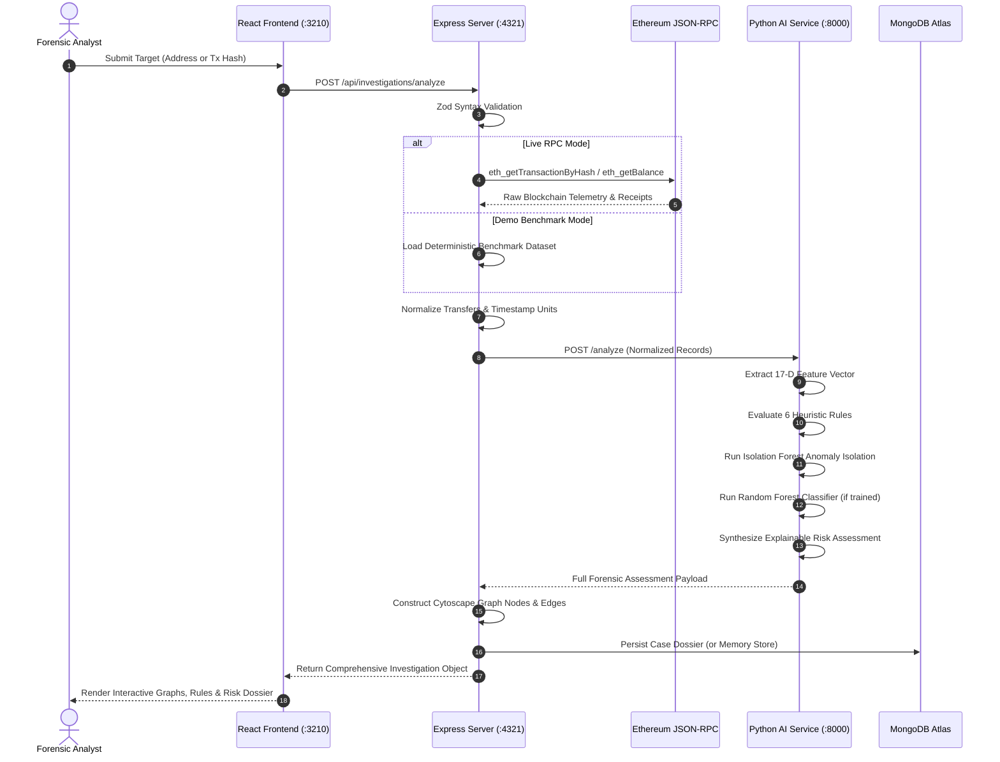

# ChainForensics System Architecture

```
+-------------------------------------------------------------------------------+
|                             CHAINFORENSICS PLATFORM                           |
|                  AI-Powered Blockchain Intelligence & Forensics               |
+-------------------------------------------------------------------------------+
```

## 1. Executive Architectural Overview

ChainForensics is built on a clean three-tier distributed architecture designed for forensic accuracy, resilience, and strict separation of concerns:

1. **Frontend Presentation Tier (Port 3210)**:
   - React 18 + Vite + TypeScript + Tailwind CSS
   - High-performance Cytoscape.js interactive network graph engine
   - Recharts analytical visualization layer
   - Fully responsive, accessible, dark cybersecurity UI with zero static mocks

2. **Backend Orchestration Tier (Port 4321)**:
   - Node.js + Express.js + TypeScript
   - Ethers.js JSON-RPC provider abstraction with automatic public failover pool
   - Zod schema validation & JWT authentication
   - Mongoose data layer (MongoDB Atlas) with automatic in-memory fallback cache
   - Helmet security headers & rate limiting

3. **AI & Forensics Engine Tier (Port 8000)**:
   - Python 3.14 + FastAPI + uvicorn
   - 17-dimensional behavioral and temporal feature extraction engine
   - 6 configurable deterministic heuristic rules
   - Unsupervised Isolation Forest multivariate anomaly isolation
   - Supervised Random Forest Classifier with precision/recall metrics
   - Multi-factor explainable risk synthesis layer

---

## 2. End-to-End Data Flow



---

## 3. Component Directory Structure

```
d:/ChainForensics/
├── client/                     # React + Vite + Tailwind + Cytoscape
│   ├── src/
│   │   ├── components/         # CytoscapeGraph, RiskScoreBadge, TransactionTable, etc.
│   │   ├── context/            # AuthContext, Global state
│   │   ├── layouts/            # AppLayout with collapsible sidebar
│   │   ├── pages/              # Landing, Dashboard, Investigate, Results, Network, History
│   │   ├── services/           # Axios API client
│   │   └── types/              # TypeScript interfaces
│   └── package.json
│
├── server/                     # Node.js + Express + TypeScript
│   ├── src/
│   │   ├── config/             # Config & env validation
│   │   ├── controllers/        # Auth, Health, Investigation
│   │   ├── middleware/         # Auth, Helmet, RateLimit, Error handling
│   │   ├── models/             # User, Investigation (Mongoose)
│   │   ├── routes/             # Express API routers
│   │   ├── services/           # BlockchainService (RPC), AIService, DemoService
│   │   └── validators/         # Zod schemas
│   ├── tests/                  # Supertest integration test suite
│   └── package.json
│
├── ai-service/                 # Python FastAPI Engine
│   ├── app/
│   │   ├── main.py             # FastAPI entrypoint
│   │   ├── schemas.py          # Pydantic data contracts
│   │   ├── features.py         # 17-Dimensional feature extraction
│   │   ├── rules.py            # Heuristic rule evaluation
│   │   ├── anomaly_service.py  # Isolation Forest anomaly isolation
│   │   ├── model_service.py    # Random Forest inference & availability
│   │   └── risk.py             # Risk assessment synthesis
│   ├── training/               # Train & evaluate scripts
│   ├── tests/                  # Pytest test suite
│   └── requirements.txt
│
└── docs/                       # Architectural & Technical Documentation
```
